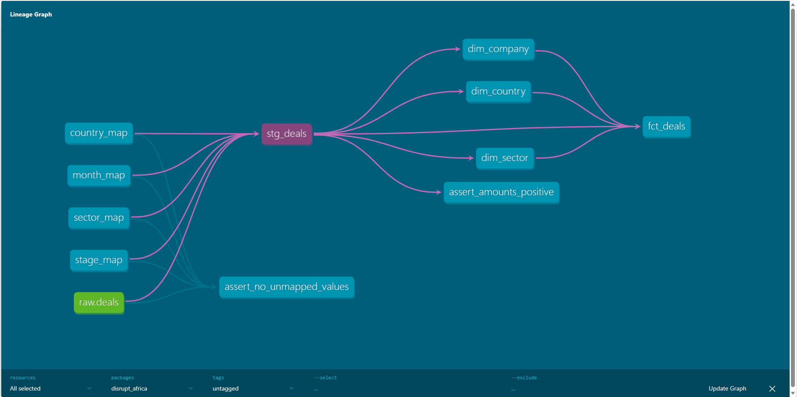

# Disrupt Africa Funding Pipeline

A dbt Core project that turns the Disrupt Africa 2025 report on funded African startups from a hand-compiled Excel sheet into a tested star schema in Postgres. The result is 178 deals across 19 countries and 22 sectors, with $1.58B in disclosed funding.

## The problem

The source sheet was built for reading, not querying. Country and sector group headers sit between the deal rows, the header labels were offset from the data, and the same sector appears under 29 spellings. Counting deals by sector on the raw file gives wrong answers.

## Pipeline

| Layer | What it does |
|---|---|
| `scripts/load_raw.py` | Finds every Excel file in `data/`, validates the 13 expected headers, drops group-header and blank rows, and loads everything as text into `raw.deals`. Re-running replaces that file's rows, so loads are idempotent. |
| `seeds/` | Four mapping files (country, sector, stage, month) that hold every cleaning rule as data. |
| `stg_deals` | Casts types, applies the seed mappings, builds `deal_id`, and removes duplicates. |
| `fct_deals` and 3 dimensions | One row per deal, with keys and measures in the fact table and descriptive attributes in `dim_country`, `dim_sector` and `dim_company`. |

## Data quality decisions

- **Duplicates:** 5 deals appeared twice, identical except that one copy had lost its source URL. Staging keeps the copy with the URL, which takes 183 loaded rows to 178 deals.
- **Sector spellings:** 29 raw spellings (`Fintech`, `fintech`, `e-heAlth`) map to 22 sectors. The join runs on the lowercased value, so new casing variants need no changes.
- **Two-month deals:** 4 deals list two months, such as "January + October". Staging uses the first month and sets `is_multi_month` so the choice stays visible.
- **Stage variants:** `Series B2 round` and `Series B2` merge into one stage, and one `Equity/debr` typo is corrected.
- **Undisclosed amounts:** 58 deals (33%) have no amount. They stay null, because a zero would distort every average and total. `has_disclosed_amount` lets queries filter on them.

## Known limitations

- 100 of 178 deals (56%) have an undisclosed stage, so stage analysis covers 78 deals.
- Amount analysis covers the 120 deals with a disclosed amount.
- The source is a single year, 2025.

## Tests

`dbt build` passes all 35 nodes: 4 seeds, 5 models and 26 tests. The tests cover unique and not-null keys, foreign keys from the fact table to every dimension, and accepted stage and funding-type values. Two custom tests fail on any amount at or below zero, and on any raw country, sector, stage or month value that has no seed mapping. The second one names the exact value to add.

## How to run

Requires Python 3.9 or higher and Postgres.

1. Create the database and two schemas: `CREATE DATABASE disrupt_africa;`, then `CREATE SCHEMA raw;` and `CREATE SCHEMA analytics;`.
2. Put the report in `data/` as `disrupt_2025.xlsx`. The file is not in this repo. It needs these headers: `startup, location, sector, month, amount_usd, investors, stage, debt_equity, female_cofounder, female_ceo, year_launched, accelerator, source_url`.
3. Install dependencies: `pip install dbt-postgres pandas openpyxl sqlalchemy psycopg2-binary`.
4. Set `PGUSER` and `PGPASSWORD` as environment variables, and point your `profiles.yml` at the `analytics` schema.
5. Run `python scripts/load_raw.py`, then `dbt build`.
6. View the docs with `dbt docs generate` and `dbt docs serve`.

## Adding a new year

Drop `disrupt_2026.xlsx` into `data/`, then run the loader and `dbt build`. The year comes from the filename. If the new file contains a spelling the seeds don't cover, the unmapped-values test fails and lists it. Add one row to the matching seed and run again.

## Stack

dbt Core, PostgreSQL, Python (pandas, SQLAlchemy).